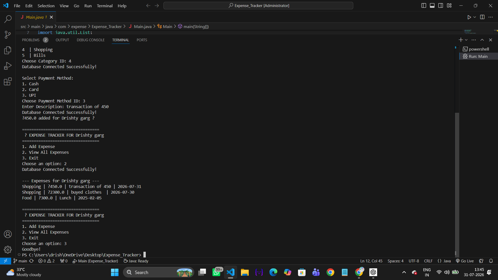

<div align="center">

# 💰 Expense Tracker

A console-based Expense Tracker application built using **Java, JDBC, MySQL, and Maven** following the **DAO (Data Access Object)** architecture for efficient expense management.


</div>

---

# 📌 Overview

Expense Tracker is a Java console application that helps users record and manage their daily expenses.

The application stores expense data in a MySQL database using JDBC connectivity and follows the DAO architecture for better code organization and maintainability.

Users can easily add new expenses, choose categories and payment methods, and view all saved expenses through a simple menu-driven interface.

---

# ✨ Features

- Add new expenses
- View all saved expenses
- Category selection
- Payment method selection (Cash, Card, UPI)
- Automatic date storage
- MySQL database integration
- JDBC connectivity
- DAO Architecture
- Menu-driven interface
- Maven project structure

---

# 🛠 Technologies Used

- Java
- JDBC
- MySQL
- Maven
- Git
- GitHub
- VS Code

---

# 📂 Project Structure

```text
Expense_Tracker
│
├── src
│   ├── main
│   │   ├── java
│   │   │   ├── DAO
│   │   │   ├── models
│   │   │   ├── services
│   │   │   ├── utils
│   │   │   └── Main.java
│   │   └── resources
│   │
│   └── test
│
├── pom.xml
└── README.md
```

---

# 🗄 Database

The project uses **MySQL** as the backend database.

### Tables

- users
- expenses
- categories
- payment_methods

The application performs database operations using **JDBC**.

---

# 🔄 Application Workflow

```text
Start Application
        │
        ▼
Enter User Name
        │
        ▼
Main Menu
   │
   ├── Add Expense
   │       │
   │       ▼
   │ Select Category
   │       │
   │       ▼
   │ Select Payment Method
   │       │
   │       ▼
   │ Save Expense in MySQL
   │
   └── View Expenses
           │
           ▼
 Retrieve Data from Database
```

---

# 📷 Application Screenshot

> Output of the Expense Tracker application

<!-- Upload screenshot named expense-output.png -->



---

# 📈 Future Enhancements

- Update existing expenses
- Delete expenses
- Income management
- Monthly expense reports
- Budget tracking
- Charts & analytics
- JavaFX GUI
- PDF report generation
- User authentication

---

# 👩‍💻 Author

**Drishty Garg**

B.Tech Information Technology

Dr. K. N. Modi Institute of Engineering and Technology

GitHub:
https://github.com/Drishtygarg

LinkedIn:
https://www.linkedin.com/in/drishty-garg-25637031b

---

<div align="center">

⭐ If you like this project, consider giving it a star.

</div>
